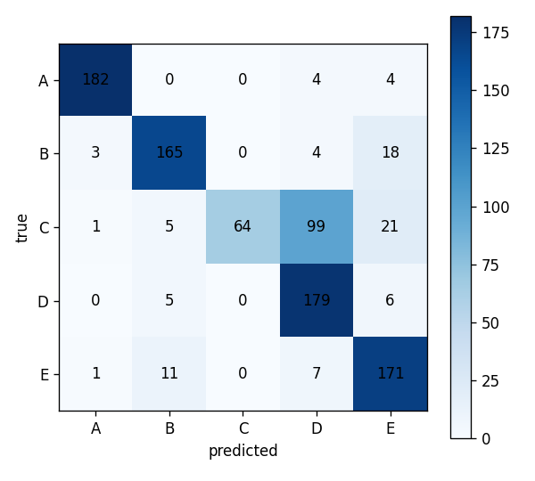

# sEMG 신호 기반 동작 분류 및 사용자 인증 연구

## 1. 코드 설명
본 연구는 표면 근전도(sEMG) 1차원 생체 신호를 연속 웨이블릿 변환(CWT) 기법을 활용해 2차원 시간-주파수 스펙트로그램 이미지로 변환한 뒤, Deep Learning 아키텍처를 적용하여 동작을 분류하고 성능을 비교 분석한 프로젝트입니다.

### 사용한 데이터 및 전처리 방법
- **데이터**: 3개 채널 sEMG(표면 근전도) 센서 데이터
- **전처리**:
  1. **잡음 제거**: 60Hz 전원선 노치 필터(Notch Filter) 및 20~499Hz 대역통과 필터(Bandpass Filter) 적용
  2. **시간-주파수 변환**: `pywt.cwt`를 사용해 Morlet 웨이블릿 기반 32스케일 CWT 스펙트로그램 생성 (3채널, 32x300 텐서 형태)
  3. **정규화**: Min-Max Scaling을 통해 0.0 ~ 1.0 범위로 정규화 수행

### 사용한 AI/ML 모델
- **DenseNet161**: Dense Block 기반의 Feature Reuse(특징 재사용) 구조로 sEMG 스펙트로그램의 미세한 주파수 파형 포착에 특화
- **ResNet18**: Residual Connection을 활용한 딥러닝 베이스라인 모델
- **2D CNN**: 2개 커스텀 Conv Layer로 구성된 기본 비교 모델

### 학습 및 테스트 방법
- **손실함수 및 최적화**: Cross-Entropy Loss, Adam Optimizer (`lr=1e-3`) 적용
- **검증 전략**: `StratifiedKFold(n_splits=5, shuffle=True, random_state=42)`를 이용한 5-Fold 교차검증 수행

### 코드 실행 방법
- 주피터 노트북 `week2.ipynb` 내 전체 셀을 순차적으로 실행 (Run All)

### 코드 파일 설명
| 파일 / 폴더 | 설명 |
| :--- | :--- |
| `week2.ipynb` | 데이터 전처리, CWT 변환, 모델 정의, 5-Fold 교차검증 및 최종 평가 전체 실행 노트북 |
| `data/` | sEMG 원본 CSV 데이터셋 저장 폴더 |
| `check_data.py` | 데이터 구조 및 셰이프 검증용 스크립트 |
| `plot_signals.py` | sEMG 시계열 신호 시각화 스크립트 |

---

## 2. 모델 성능 비교

### 모델별 성능 비교표

| Model | Accuracy | Precision | Recall | F1-score |
| :--- | :---: | :---: | :---: | :---: |
| **ResNet18** | **0.8232** | - | - | **0.8213** |
| **DenseNet161** | **0.8011** | **0.850** | **0.881** | **0.7845** |
| **2D CNN** | 0.5526 | - | - | 0.5280 |

> **DenseNet161 상세 지표**
> - **5-Fold 교차검증 평균 정확도**: 80.24% (± 5.76%)
> - **총 파라미터 수**: 26,483,045 개 (약 26.48M)
> - **샘플당 추론 속도**: 30.29 ms / sample (macOS MPS 가속 기준)

### 성능 분석
- **우수 모델**: **ResNet18** (Macro F1: 0.8213) 및 **DenseNet161** (Macro F1: 0.7845)
- **분석 내용**
  - 단순 구조의 **2D CNN**(0.5280) 대비, Residual 및 Dense 계열의 스킵 연결(Skip Connection)을 포함한 아키텍처가 CWT 스펙트로그램의 미세한 시간-주파수 특징을 정밀하게 추출해 월등히 높은 분류 성능을 보여줌.
  - DenseNet161은 높은 파라미터 수(약 26.48M)에도 불구하고 MPS 가속을 통해 샘플당 약 30.29ms의 빠른 성능을 확보함.

  ## 3. Confusion Matrix 분석

### Model: DenseNet161 성능 상세 분석

* **가장 잘 분류된 클래스**: **Class A** (정확도 96.6% / 198개 중 182개 적중) 및 **Class D** (정확도 94.2% / 190개 중 179개 적중)
* **가장 많이 오분류된 클래스**: **Class C** (정확도 33.7% / 190개 중 64개만 적중)
* **주요 오분류 유형**: **True Class C → Predicted Class D** (총 **99건** 오분류 발생)
* **오분류 원인 분석**:
  - Class C와 Class D의 sEMG 근전도 신호 패턴 및 CWT 스펙트로그램 특징이 서로 매우 유사함.
  - 이로 인해 DenseNet161 모델이 두 클래스 간의 경계를 명확하게 구분하지 못하고, 상대적으로 데이터 특징이 강한 Class D로 편향되어 예측하는 현상이 나타남.

---

## 4. 최종 결과

### 실험 결과 요약
* **가장 성능이 우수한 모델**: **ResNet18** (Accuracy: 0.8232, F1-Score: 0.8213) 및 **DenseNet161** (Accuracy: 0.8011, F1-Score: 0.7845)
* **가장 성능이 낮은 모델**: **2D CNN** (Accuracy: 0.5526, F1-Score: 0.5280)
* **주요 개선 대상 클래스**: **Class C** (Class D와의 상호 오분류 개선 필요)

### 전체적인 실험 결과 및 느낀 점
* **CWT 기반 스펙트로그램 변환의 효과**
  - 1차원 sEMG 신호를 CWT를 통해 2차원 시간-주파수 스펙트로그램으로 변환하여 학습시킨 결과, 단순 구조인 2D CNN(55.26%)보다 깊은 아키텍처인 ResNet18(82.32%)과 DenseNet161(80.11%)에서 성능이 대폭 상승하는 것을 확인했습니다.

* **지표 분석을 통한 오분류 원인 발견**
  - 전체 정확도만 보았을 때는 모델 성능이 양호해 보였으나, Confusion Matrix를 통해 세부 결과를 확인하니 Class C 데이터가 Class D로 대량 오분류(190건 중 99건)되고 있는 명확한 한계를 발견했습니다.
  - 단일 지표(Accuracy)만 확인하기보다 혼동 행렬과 클래스별 F1-score를 함께 분석하는 것이 모델의 실질적인 성능 평가에 꼭 필요하다는 점을 배웠습니다.

* **아쉬운 점 및 향후 시도해볼 점**
  - Class C와 D의 신호 특징이 유사해 발생하는 오분류 문제를 해결하기 위해, CWT 변환 시 파라미터를 변경해보거나 특정 클래스에 가중치를 주는 손실 함수(Class Weight)를 적용해 보는 보완 작업이 필요함을 느꼈습니다.